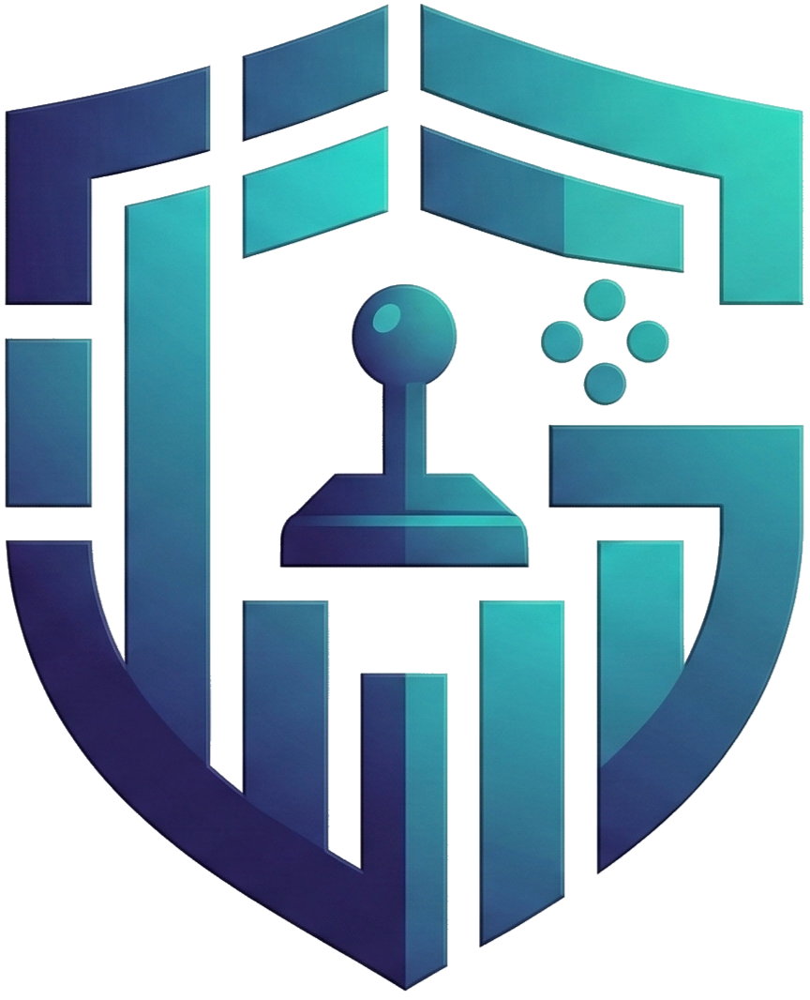
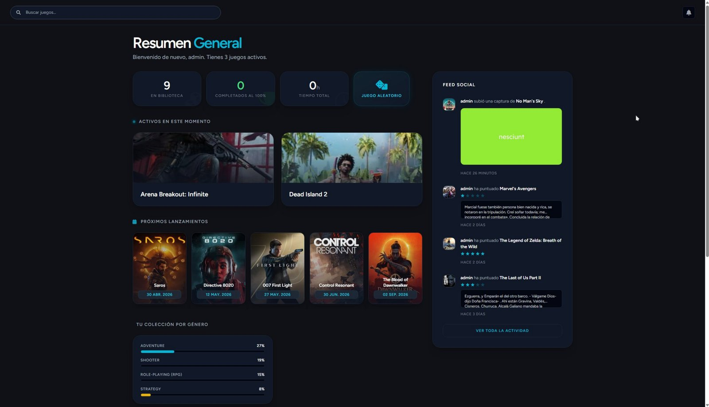
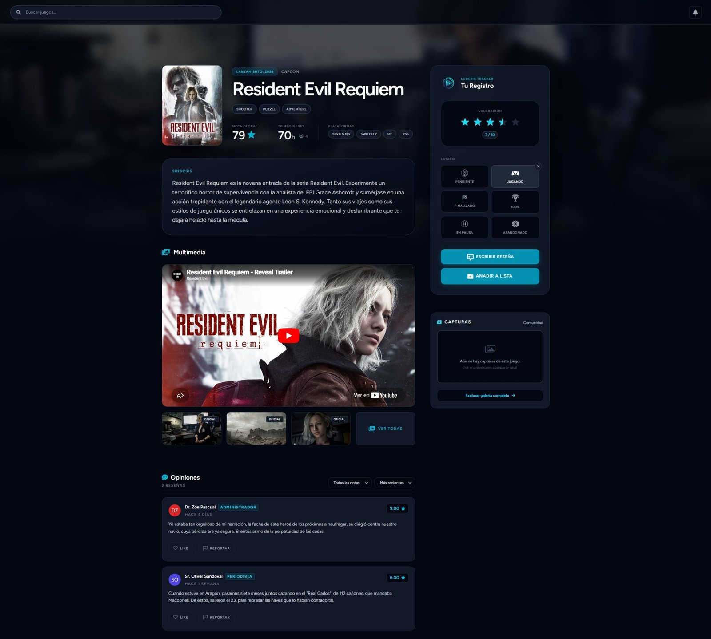
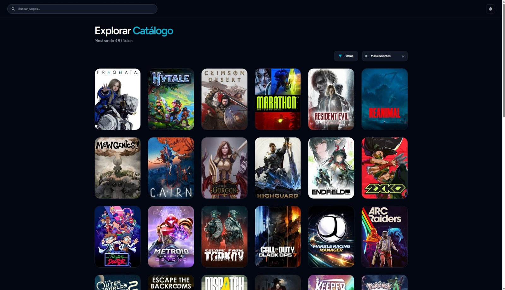
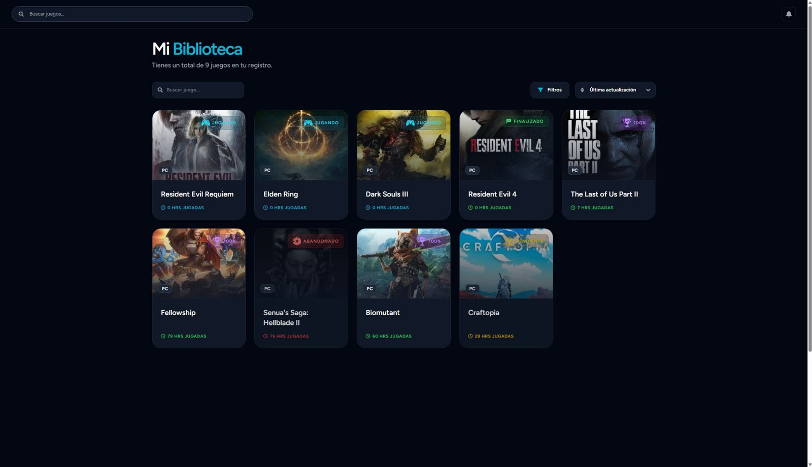
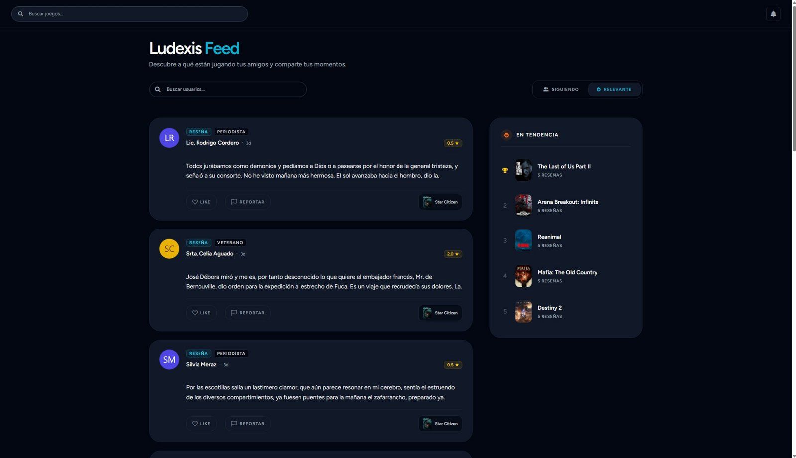
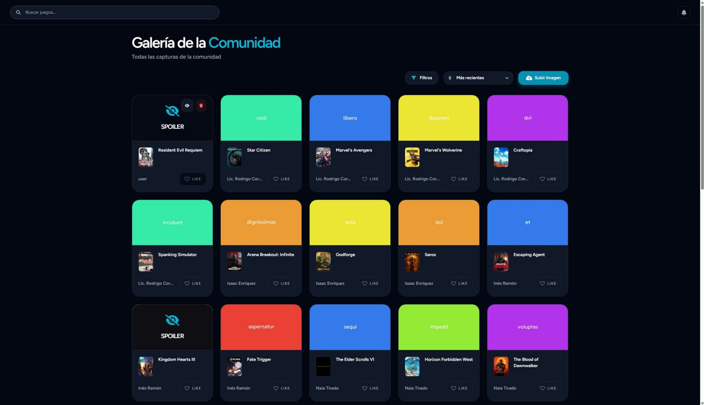
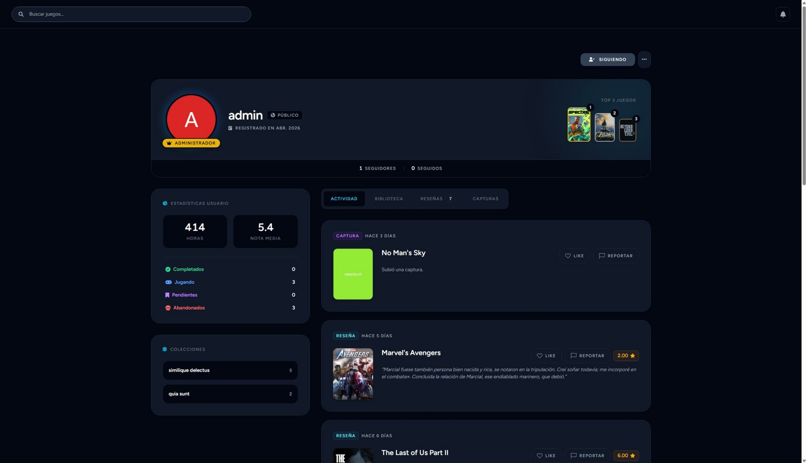

<p align="center">
  
</p>

<h1 align="center">Ludexis</h1>

<p align="center">
  Red social y gestor de colecciones de videojuegos.<br>
  Organiza tu biblioteca, comparte lo que juegas y descubre qué juega tu gente.
</p>

<p align="center">
  
  
  
  
  
  
</p>

---

## Sobre el proyecto

Ludexis es mi Proyecto Intermodular del Grado Superior en Desarrollo de Aplicaciones Web (2025-2026).

Hoy, quien juega a videojuegos tiene la información repartida en varias webs: una para llevar la colección, otra para leer reseñas y otra para hablar con amigos. Ludexis lo junta todo en un mismo sitio: llevas tu biblioteca, publicas reseñas y capturas, y sigues la actividad de otros jugadores.

## Capturas

<p align="center">
  
</p>

| Ficha de juego | Catálogo |
| --- | --- |
|  |  |

| Mi biblioteca | Feed social |
| --- | --- |
|  |  |

| Galería | Perfil |
| --- | --- |
|  |  |

## Funcionalidades

### Biblioteca y listas
- Biblioteca personal con el estado de cada juego (completado, pendiente, abandonado...) y las horas jugadas.
- Listas personalizadas para agrupar juegos como quieras.
- Selector de juego aleatorio entre tus pendientes, para cuando no sabes a qué jugar.

### Catálogo conectado a IGDB
- Catálogo con búsqueda, filtros por plataforma y género, y ordenación.
- Integración con la **API de IGDB**: si un juego no está en la base de datos local, se importa automáticamente con sus datos oficiales (portada, vídeo, desarrolladora, géneros, plataformas).
- Comando para importar los juegos más populares: `php artisan igdb:import-popular`.

### Parte social
- Sistema de seguidores, feed social y timeline cronológico con la actividad de tu red.
- Reseñas con "me gusta" y galería de capturas con filtro anti-spoilers obligatorio.
- Notificaciones dentro de la aplicación.
- Perfiles públicos o privados.

### Valoraciones contra el review bombing
La nota de cada juego es una media ponderada: el voto de cada usuario pesa según su rol (estándar **x1.0**, veterano **x1.5**, periodista **x3.0**), y la nota oficial de IGDB entra en el cálculo como referencia. Así unas pocas cuentas no pueden hundir o inflar la nota de un juego.

### Experiencia y rangos
Los usuarios ganan experiencia al publicar reseñas, subir capturas y recibir "me gusta", y suben de rango: Espectador, Explorador, Coleccionista, Completista y Veterano. Al llegar a Veterano, su voto pasa a pesar más.

### Cuentas y moderación
- Inicio de sesión con **Steam**, **Discord** y **Google** (Laravel Socialite), además del registro clásico.
- Autenticación en dos pasos (Jetstream).
- Sistema de reportes y panel de moderación para administradores.

## Stack

| Capa | Tecnologías |
| --- | --- |
| Backend | PHP 8.2, Laravel 12 (MVC), Jetstream, Sanctum |
| Frontend | Livewire 3, Alpine.js, JavaScript, Tailwind CSS, Vite |
| Base de datos | MySQL |
| Integraciones | API de IGDB, Laravel Socialite (Steam, Discord, Google) |
| Despliegue | Servidor propio: Orange Pi 5 Pro con Ubuntu 24.04, Nginx Proxy Manager y DuckDNS |

## Instalación en local

Requisitos: PHP 8.2+, Composer, Node.js y MySQL.

```bash
git clone https://github.com/antoniomedi6/Ludexis.git
cd Ludexis

composer install
npm install

cp .env.example .env
php artisan key:generate
```

Configura en `.env` la conexión a MySQL y las credenciales de IGDB (`TWITCH_CLIENT_ID` y `TWITCH_CLIENT_SECRET`, que se obtienen gratis en la consola de desarrolladores de Twitch). Las de Steam, Discord y Google son opcionales y solo hacen falta para iniciar sesión con esas cuentas.

```bash
php artisan migrate --seed
php artisan igdb:import-popular 100   # opcional: importa 100 juegos populares

npm run dev
php artisan serve
```

La aplicación queda disponible en `http://localhost:8000`.

## Autor

**Antonio Medina Cazorla**, desarrollador web full stack (Almería).

- LinkedIn: [antoniomedinacazorla](https://www.linkedin.com/in/antoniomedinacazorla)
- GitHub: [antoniomedi6](https://github.com/antoniomedi6)
